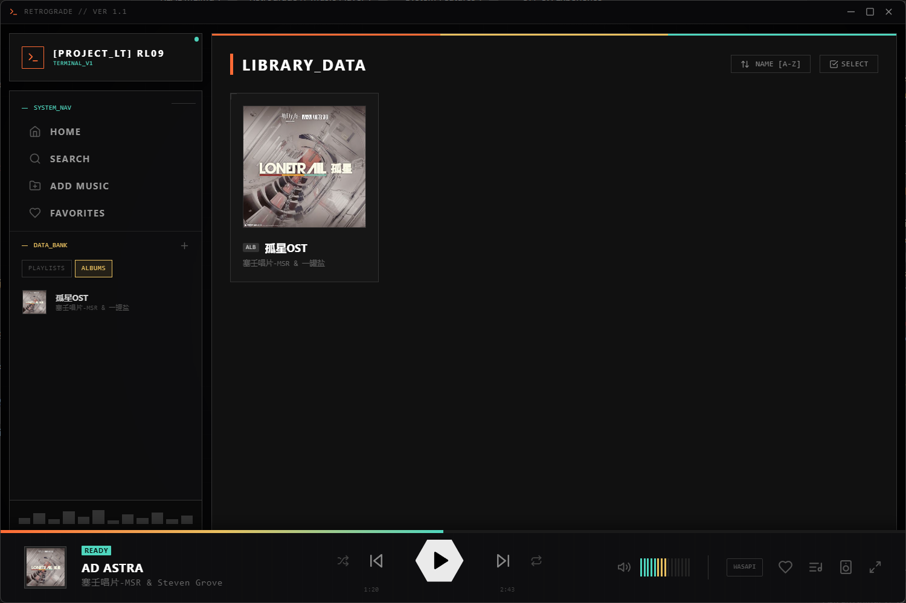
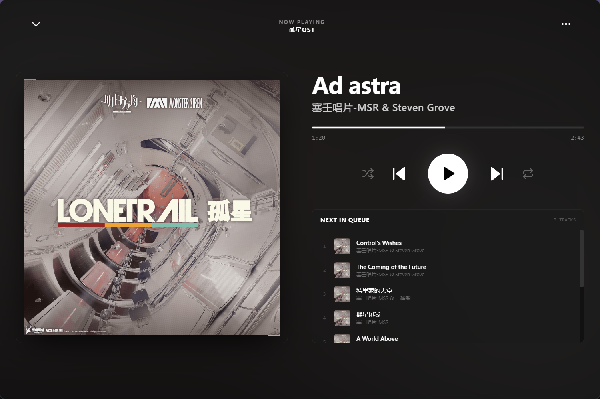

<div align="center">

# Rustygrade


**A native Linux music player for people who care how their library sounds and looks.**
Gapless and bit-perfect playback on libmpv, PipeWire and ALSA, a fast library scanner, and a dark, high-contrast interface drawn on the GPU with iced.

| **Library** | **Full-screen player** |
|:---:|:---:|
|  |  |

</div>

---

## Highlights

- **One native binary.** About 20 MB, no bundled runtime, close to 0% CPU while idle. `libmpv` and `libasound` are loaded at runtime.
- **Playback that gets out of the way.** Gapless, crossfade, ReplayGain, a 10-band equalizer, and a direct ALSA mode for bit-perfect output with hardware volume.
- **Your library, understood.** Multi-disc albums, compilations, per-track artists, embedded or folder cover art, play counts and smart playlists.
- **Part of the desktop.** MPRIS (media keys, `playerctl`, shell widgets), a system tray, XDG file portals, Wayland and X11.

---

## Features

### Audio
| | |
|---|---|
| **Engine** | libmpv in-process, output through PipeWire with ALSA as a fallback |
| **Gapless** | The next track is queued ahead of time, so albums play straight through |
| **Crossfade** | 2–12 s equal-power overlap; an album played in order stays gapless |
| **Equalizer** | 10 octave bands (32 Hz – 16 kHz), ±12 dB, presets, changed live |
| **ReplayGain** | Off, track or album |
| **Output routing** | Pick a PipeWire device, or Direct ALSA for bit-perfect output with hardware volume |
| **Stream inspector** | Codec, bit depth, sample rate and channels for FLAC, WAV, ALAC, MP3, AAC, OGG, OPUS, WMA |

### Library
- **Scanner:** add folders or files from `ADD MUSIC`, drop them on the window (X11/XWayland), or rescan with `F5`. Changed files are re-read, new ones added, and missing ones removed only after you confirm.
- **Folder watching:** new files appear a few seconds after they land.
- **Albums and artists:** a grid for both, artist pages with most-played tracks and every album.
- **Cover art:** embedded art or `cover` / `folder` / `front` images, cached as thumbnails plus full-size covers.
- **Favorites and playlists:** Liked Songs, custom playlists with their own covers, hold-and-drag to reorder.
- **Smart playlists:** rules over format, bit depth, sample rate, year, length, plays, last played, date added, favorite and text fields, matched on all or any, with an order and a limit.
- **Tag editor:** edit title, artist, album, album artist, year, track/disc number and cover for a track or a whole album; changes are written into the files.
- **Queue:** *Add to Queue*, *Play Next*, shuffle across the whole library, and session restore on the next start.
- **Synced lyrics:** read locally from a sibling `.lrc` file or the lyrics tag; the current line lights up and clicking a line seeks to it.

### Interface
- Borderless window with a custom title bar and edge/corner resizing.
- Collapsible sidebar rail (`Ctrl+B`).
- Full-screen player with a blurred cover backdrop and the upcoming queue.
- 400×122 mini player with a spinning vinyl fallback (`Ctrl+M`).
- Accent colour taken from the playing cover.
- Optional Discord Rich Presence, off by default.

---

## Tech stack

| Layer | Choice |
|---|---|
| Language | [Rust](https://www.rust-lang.org/), edition 2024 (1.89+) |
| UI | [iced](https://iced.rs) 0.14 — wgpu (Vulkan/GL) with a tiny-skia CPU fallback, Wayland and X11 |
| Audio | [mpv](https://mpv.io/) via `libmpv`, PipeWire bridge sink, direct ALSA |
| Async runtime | [tokio](https://tokio.rs/) |
| Desktop integration | MPRIS over D-Bus ([zbus](https://github.com/dbus2/zbus)), tray ([ksni](https://github.com/iovxw/ksni)), XDG portals ([ashpd](https://github.com/bilelmoussaoui/ashpd)) |
| Metadata | [lofty](https://github.com/Serial-ATA/lofty-rs) |
| Images | [image](https://github.com/image-rs/image) + [fast_image_resize](https://github.com/Cykooz/fast_image_resize) |
| Parallelism | [rayon](https://github.com/rayon-rs/rayon) for scanning and cover work |

### Layout

```
rustygrade/
├── assets/                  # Icon and screenshots
├── crates/
│   ├── rustygrade-app/      # iced UI and the playback/library coordinator (binary: rustygrade)
│   ├── rustygrade-audio/    # libmpv engine, direct ALSA output, PipeWire bridge
│   ├── rustygrade-core/     # Library, scanner, covers, playlists, settings, session, lyrics
│   └── rustygrade-linux/    # MPRIS, tray, portals, single instance, GPU policy
├── packaging/linux/         # install.sh, package.sh, desktop entry, icon
└── Cargo.toml               # Cargo workspace
```

---

## Install

### 1. Runtime libraries

| Distro | Command |
|---|---|
| Arch | `sudo pacman -S mpv alsa-lib pipewire` |
| Debian / Ubuntu | `sudo apt install libmpv2 libasound2 libpipewire-0.3-0` |

Background play (keep playing after closing the window) needs a shell that hosts StatusNotifierItem tray icons. Without one, closing the window quits the app.

### 2. Build

You need Rust 1.89 or newer, `pkg-config`, `clang`, and the PipeWire development files (`libpipewire-0.3-dev` on Debian/Ubuntu, `pipewire` on Arch).

```bash
git clone https://github.com/Okarin2507/rustygrade.git
cd rustygrade
cargo build --release -p rustygrade-app    # produces target/release/rustygrade
```

### 3. Install for your user

```bash
packaging/linux/install.sh
```

This puts the binary in `~/.local/opt/rustygrade`, a `rustygrade` launcher in `~/.local/bin`, a desktop entry in the app drawer, and the icon in the hicolor theme. Make sure `~/.local/bin` is on your `PATH`.

To remove it (your library is kept):

```bash
packaging/linux/install.sh uninstall
```

To build a distributable tarball instead: `packaging/linux/package.sh` → `dist/rustygrade-<version>-linux-<arch>.tar.gz`, which contains its own `install.sh`.

To just try it without installing: `cargo run --release -p rustygrade-app`.

---

## Using Rustygrade

### First start
1. Open `ADD MUSIC` and choose `SCAN_FOLDER` (or `SCAN_FILES`). Pick your music folder.
2. Rustygrade indexes tags and covers in the background; albums appear as they are found.
3. Click an album to open it, then press play, or press `Space` to start playback.

### Playing music
- Right-click any track or album for the context menu: like, add to queue, play next, add to playlist, edit tags, delete.
- Open the **sound popup** from the player bar to choose the output device, switch to Direct ALSA, set ReplayGain, adjust the equalizer, and set the crossfade length.
- Click the artist line on an album or in the player bar to jump to that artist's page.
- Turn on **SELECT** mode to act on several albums at once.

### Playlists
- Create playlists from the sidebar and give them a cover.
- Hold a track and drag it to reorder it.
- Build **smart playlists** from rules; they update themselves as the library and play counts change.

### Lyrics
Place a `.lrc` file with the same name next to a track, or embed lyrics in its tags. Timestamped lyrics highlight the current line, and clicking a line seeks to it.

### Keyboard shortcuts

| Action | Shortcut |
|---|---|
| Play / pause | `Space` |
| Previous / next track | `←` / `→`, media keys |
| Seek −10 s / +10 s | `Shift+←` / `Shift+→` |
| Volume down / up | `J` / `K` or `↓` / `↑`, or scroll over the volume bars |
| Mute | `M` |
| Shuffle / repeat | `Ctrl+S` / `Ctrl+R` |
| Full-screen player | `F` |
| Mini player | `Ctrl+M` |
| Collapse sidebar | `Ctrl+B` |
| Search the library | `/` or `Ctrl+F` |
| Rescan library | `F5` |
| Show all shortcuts | `?` |
| Close overlays | `Esc` |

Pressing *Previous* after the first three seconds of a track restarts it instead of going back.

### Media keys and desktop widgets
Rustygrade registers as an MPRIS player, so media keys, `playerctl` and shell widgets show the title, artist, album, cover and position, and can play, pause, skip, seek and change the volume.

```bash
playerctl -p rustygrade play-pause
```

### Wayland notes
- Dropping files onto the window works on X11/XWayland only; on native Wayland use `ADD MUSIC`.
- Always-on-top and remembered window position for the mini player depend on the compositor.

---

## Data and configuration

Everything lives in `~/.rustygrade`:

| File | Contents |
|---|---|
| `library.json` | Tracks and albums |
| `native-settings.json` | Settings |
| `native-collections.json` | Playlists and smart playlists |
| `native-session.json`, `native-queue.json` | Restored queue and playback position |
| `native-stats.json` | Play counts and history |
| `covers/` | Thumbnails and full-size covers |

Damaged library and playlist files are restored from their `.bak` copies. Errors are logged to `~/.rustygrade/native-error.log`.

### Environment variables

| Variable | Effect |
|---|---|
| `RETRO_APPDIR=<dir>` | Use another data folder, and run as a separate instance |
| `ICED_BACKEND=tiny-skia` | Force CPU rendering |
| `WGPU_BACKEND`, `WGPU_POWER_PREF` | Override the GPU the renderer picks |

The renderer can also be chosen in **Settings** (integrated GPU, discrete GPU or CPU; applied on restart).
